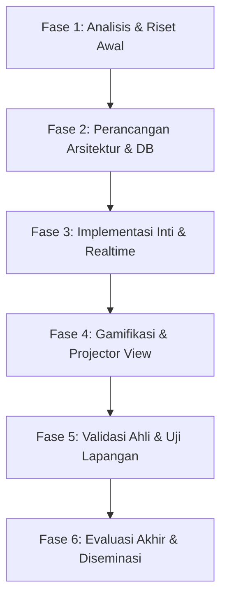

# 📘 BUKU PERENCANAAN SKRIPSI
## Clash of Class — Platform Media Kuis Interaktif Real-Time Berbasis Gamifikasi dan Board Claiming

> **Program Studi:** Pendidikan Teknologi Informasi (PTI)  
> **Jenis Penelitian:** Research & Development (R&D)  
> **Metode Pengembangan:** Model ADDIE (*Analysis, Design, Development, Implementation, Evaluation*)  
> **Disusun Oleh:** [Nama Mahasiswa] — [NIM]  
> **Dosen Pembimbing:** [Nama Dosen Pembimbing]  
> **Tahun Akademik:** 2025/2026  

---

## 🗺️ DAFTAR ISI DOKUMEN PERENCANAAN

1. [Status & Konteks Proyek](#1-🖥️-status--konteks-proyek)
2. [Rekomendasi Judul Sempro](#2-📝-rekomendasi-judul-sempro)
3. [Etika Akademik — Open-Source & Referensi Proyek](#3-⚖️-etika-akademik--open-source--referensi-proyek)
4. [Observasi Awal ke Sekolah](#4-🏫-observasi-awal-ke-sekolah)
5. [Kajian Teori yang Diperlukan](#5-📚-kajian-teori-yang-diperlukan)
6. [Daftar Isi Skripsi (Format Akademik)](#6-📋-daftar-isi-skripsi-format-akademik)
7. [Struktur Sempro BAB I–III](#7-🏗️-struktur-sempro-bab-i–iii)
8. [Rencana Pengembangan Teknis](#8-🔧-rencana-pengembangan-teknis)
9. [Instrumen Penelitian](#9-📊-instrumen-penelitian)
10. [Referensi Jurnal & Kata Kunci Pencarian](#10-🔎-referensi-jurnal--kata-kunci-pencarian)
11. [Mapping Teknologi ke Teori](#11-🗺️-mapping-teknologi-ke-teori)
12. [Timeline 6 Bulan](#12-📅-timeline-6-bulan)
13. [Checklist Persiapan Sempro](#13-✅-checklist-persiapan-sempro)

---

## 1. 🖥️ STATUS & KONTEKS PROYEK

### 1.1 Deskripsi Proyek

**Clash of Class** adalah platform media evaluasi pembelajaran interaktif berbasis web yang memadukan kuis pengetahuan dengan mekanisme kompetisi *real-time* (*game show / board claiming*). Platform ini terinspirasi dari dinamika arena kompetisi akademik (seperti *Clash of Champions* dan *Jeopardy*), di mana peserta didik tidak hanya mengerjakan soal secara pasif dan terisolasi, melainkan berkompetisi aktif di dalam sebuah arena soal bersama (*shared battle board*).

Berbeda dengan aplikasi kuis konvensional (seperti Google Forms yang statis, maupun Kahoot/Quizizz yang umumnya menyajikan soal secara linear berurutan ke semua siswa sekaligus), **Clash of Class** menghadirkan mekanisme **rebutan soal taktis (*board claiming*)**:
- Seluruh butir soal ditampilkan dalam sebuah papan matriks interaktif di layar arena.
- Siswa (atau tim) harus memilih dan **mengunci (*lock*)** soal secara eksklusif selama maksimal 60 detik.
- Sistem menerapkan penguncian atomik (*atomic lock*) di level basis data: jika satu siswa sedang mengunci soal tersebut, siswa lain tidak dapat membukanya dan harus mengincar soal lain atau menunggu soal tersebut gagal dijawab (*steal mechanism*).
- Jika siswa gagal menjawab atau waktu habis (*timeout*), soal akan terbuka kembali (*auto-release*) dan peserta tersebut terkena penalti *cooldown* agar tidak terjadi monopoli/trolling.
- Guru bertindak sebagai *Game Master / Host* yang mengendalikan jalannya sesi, memantau pergerakan papan secara *live*, dan menayangkan *Projector Mode* (papan arena raksasa dan podium animasi) di layar depan kelas.

**Karakteristik Utama:**
- 🌐 **Berbasis Web & Serverless**: Siswa cukup memasukkan Room PIN 6-karakter dan nama tanpa registrasi akun rumit; kompatibel untuk HP (mobile), tablet, dan laptop.
- ⚡ **Sinkronisasi Real-Time Super Cepat**: Memanfaatkan arsitektur WebSocket Supabase Realtime (Broadcast & Presence) serta BroadcastChannel API untuk sinkronisasi multi-tab/multi-layar tanpa delay.
- 🔒 **Atomic Concurrency Control**: Menjamin integritas perebutan soal saat 30+ siswa mengklik soal pada milidetik yang sama tanpa terjadi *race condition*.
- 👥 **Dukungan Mode Fleksibel**: Mode Individu (adu cepat mandiri) dan Mode Tim/Kelompok (*Team Collaboration & Sync View*).
- 🖥️ **Dual Interface (Host & Participant)**: Dashboard Guru yang dilengkapi kendali darurat (*Force Unlock, Kick Player, Pause, Export CSV*) dan *Projector Mode* untuk visualisasi spektakuler di kelas.
- 🎮 **Aset Gamifikasi Kental**: Desain bertema *Cyber Game Arena* dengan palet warna kontras tinggi, audio sintesis (buzzer, fanfare kemenangan, detak jantung 10 detik terakhir), dan efek selebrasi *confetti*.

**Status Proyek:** Dikembangkan secara mandiri (*greenfield R&D*) menggunakan ekosistem modern Next.js App Router dan Supabase BaaS, serta telah berhasil diuji dan dideploy ke infrastruktur komputasi awan Vercel.

> [!IMPORTANT]
> **Nilai Kebaruan (*Novelty*) Akademik:**  
> Kebaruan penelitian ini bukan sekadar membuat aplikasi kuis daring, melainkan terletak pada **integrasi mekanisme perebutan soal atomik (*atomic board claiming*) dan sinkronisasi real-time dalam skenario penilaian formatif kelas**. Mekanisme ini mengubah dinamika evaluasi pembelajaran dari aktivitas individual yang monoton menjadi pengalaman belajar yang memicu *flow*, keterlibatan aktif (*engagement*), kemampuan pengambilan keputusan cepat, serta kolaborasi kelompok secara serentak.

---

### 1.2 Tabel Stack Teknologi

| No | Lapisan Arsitektur | Teknologi / Pustaka | Versi | Peran & Alasan Pemilihan dalam Sistem |
|---|---|---|---|---|
| 1 | **Frontend Framework** | Next.js (App Router) | 16.x / 15.x | Server-Side Rendering (SSR), Client Components interaktif, struktur routing modular, performa optimal |
| 2 | **Bahasa Pemrograman** | TypeScript | 5.x | *Type safety*, meminimalisir kesalahan runtime pada payload WebSocket dan state permainan yang kompleks |
| 3 | **Styling & Design System** | Tailwind CSS + `clsx` + `tailwind-merge` | 4.x | Desain responsif bertema *Cyber Game Arena*, animasi status kartu (Available, Locked, Solved), transisi mulus |
| 4 | **Backend Architecture** | Serverless Architecture (Edge/Node.js Functions) | — | Hosting hemat biaya dan auto-scalable di Vercel tanpa butuh pengelolaan VPS Linux mandiri |
| 5 | **Database Engine** | PostgreSQL (Supabase BaaS) | 15.x | Basis data relasional tangguh; mendukung query atomik, integritas data, dan stored procedure |
| 6 | **Atomic Concurrency Control** | PostgreSQL Stored Procedure (`claim_question_lock`) | PL/pgSQL | Mencegah *race condition* saat banyak siswa merebut soal yang sama di milidetik identik |
| 7 | **Real-Time Communication** | Supabase Realtime Engine | Latest | Protokol WebSocket berbasis Elixir Phoenix Channels untuk broadcast event `LOCKED`, `SOLVED`, `RELEASED` |
| 8 | **Local Multi-Tab Sync** | BroadcastChannel API (Web API) | Native | Menjaga sinkronisasi instan antar-tab/window browser pada perangkat yang sama tanpa membebani server |
| 9 | **Audio Feedback Engine** | Web Audio API / Howler.js | Native / 2.x | Pemicu efek suara gamifikasi (klik taktil, buzzer kunci soal, detak detik kritis, fanfare poin) |
| 10 | **Visual Reward System** | `canvas-confetti` | 1.9.x | Efek visual selebrasi konfeti saat jawaban benar dan saat pengumuman juara di leaderboard |
| 11 | **Komponen Ikon** | Lucide React | 1.16.x | Ikonografi modern, konsisten, dan ringan di seluruh antarmuka peserta dan guru |
| 12 | **Penyimpanan Sesi Klien** | Web Storage API (LocalStorage) | Native | Menyimpan token sesi peserta dan status room sementara agar tidak hilang saat halaman di-refresh |
| 13 | **Pelaporan & Analitik** | CSV Exporter Engine | Native JS | Memungkinkan guru mengunduh rekapitulasi nilai dan rekam jejak pengerjaan soal secara langsung |
| 14 | **Infrastruktur Hosting** | Vercel Platform | — | Distribusi edge global dengan integrasi CI/CD otomatis dari repositori Git |

---

## 2. 📝 REKOMENDASI JUDUL SEMPRO

### 2.1 Judul Utama (Sangat Direkomendasikan)

> **"Pengembangan Media Kuis Interaktif Real-Time 'Clash of Class' Berbasis Gamifikasi untuk Meningkatkan Keterlibatan dan Hasil Belajar Siswa SMK"**

*Karakteristik Judul:* 18 kata, lugas, memenuhi kaidah frasa nomina ilmiah, mencakup nama produk (*Clash of Class*), klasifikasi media, variabel dampak (keterlibatan & hasil belajar), dan subjek penelitian spesifik.

---

### 2.2 Alternatif Pilihan Judul

| No | Format Judul Alternatif | Pendekatan Utama | Keunggulan & Rasionalisasi |
|---|---|---|---|
| 1 | *Pengembangan Media Pembelajaran Evaluasi Interaktif Berbasis Web (Clash of Class) dengan Model ADDIE pada Siswa SMK Kelas X* | R&D Murni + Prosedural | Menyebutkan model pengembangan (ADDIE) dan jenjang kelas secara eksplisit; sangat disukai dosen penguji metodologi klasik. |
| 2 | *Rancang Bangun Platform Kuis Kompetisi Real-Time 'Clash of Class' Menggunakan Arsitektur Serverless dan Supabase Realtime untuk Asesmen Formatif* | Rekayasa Perangkat Lunak (EdTech) | Menonjolkan kecanggihan teknis arsitektur web modern (*serverless* & *real-time*) dalam memecahkan masalah asesmen formatif. |
| 3 | *Pengaruh Penggunaan Media Kuis Real-Time Berbasis Board Claiming (Clash of Class) terhadap Motivasi dan Hasil Belajar Siswa* | R&D dengan Uji Efektivitas (Quasi-Experiment) | Sangat kuat jika penelitian ditargetkan menguji peningkatan skor (*N-Gain*) dan motivasi melalui uji coba kelas eksperimen vs kontrol. |
| 4 | *Pengembangan Media Kuis Game-Show Kolaboratif (Clash of Class) untuk Meningkatkan Keterlibatan Aktif Siswa dalam Pembelajaran Informatika* | Pedagogis + Gamifikasi | Fokus mendalam pada aspek psikologi belajar (*active engagement*) dan dinamika kolaborasi kelompok (*team mode*). |

---

### 2.3 Tabel Konstruksi dan Bedah Anatomi Judul

| Elemen Judul | Komponen pada Proyek | Rasionalisasi Ilmiah |
|---|---|---|
| **Aktivitas Ilmiah** | Pengembangan (*Development*) | Menandakan penelitian berjenis R&D (menghasilkan produk berstandar teruji, bukan sekadar survei/korelasi). |
| **Bentuk Artefak** | Media Kuis Interaktif Real-Time | Menegaskan klasifikasi artefak sebagai media evaluasi digital yang beroperasi secara sinkron (*synchronous*). |
| **Identitas Produk** | Clash of Class | Memberikan merek pembeda (*brand identity*) yang merefleksikan suasana arena kompetisi kelas. |
| **Landasan Pendekatan** | Berbasis Gamifikasi (*Board Claiming*) | Menunjukkan teori pedagogi dasar (penerapan elemen mekanik game show ke dalam ranah non-game/edukasi). |
| **Variabel Dependen** | Keterlibatan (*Engagement*) & Hasil Belajar | Parameter akademis yang diukur perubahannya setelah media diimplementasikan di kelas. |
| **Subjek Penelitian** | Siswa SMK (Jurusan RPL/TKJ/Informatika) | Lokus spesifik pengguna uji coba yang membutuhkan metode pembelajaran dinamis. |

---

## 3. ⚖️ ETIKA AKADEMIK — OPEN-SOURCE & REFERENSI PROYEK

Dalam penulisan skripsi bidang rekayasa perangkat lunak pendidikan (EdTech), pemanfaatan pustaka open-source dan adopsi pola arsitektur modern adalah hal yang lazim dan dianjurkan, asalkan mematuhi prinsip kejujuran akademik (*academic integrity*).

### 3.1 Panduan Do's and Don'ts

| ✅ DO (Wajib Dilakukan) | ❌ DON'TS (Pantangan Keras) |
|---|---|
| Menjelaskan secara transparan di BAB III bahwa platform dibangun menggunakan pustaka open-source (Next.js, Tailwind, Supabase, Lucide). | Mengklaim bahwa seluruh infrastruktur WebSocket dan database server dibangun sendiri dari baris pertama (*reinventing the wheel*). |
| Menyebutkan lisensi open-source (MIT License) dari pustaka yang digunakan pada lampiran dokumen skripsi. | Menghapus *attribution comment* atau *license header* dari pustaka pihak ketiga di kode sumber. |
| Membedah kontribusi orisinal peneliti: arsitektur state machine soal, algoritma atomic locking, logika cooldown anti-troll, serta adaptasi pedagogis kuis. | Menjiplak mentah-mentah repositori kuis orang lain tanpa melakukan rancang bangun dan modifikasi substantif. |
| Menguraikan alasan teknis pemilihan stack (misal: mengapa Supabase Realtime dipilih dibanding server WebSocket kustom untuk Vercel). | Menyembunyikan dependensi eksternal seolah-olah sistem berjalan secara magis tanpa infrastruktur pihak ketiga. |
| Menguji kelayakan media melalui instrumen ahli media, ahli materi, dan respons siswa secara faktual di lapangan. | Memanipulasi data uji coba atau data angket kepuasan siswa. |

---

### 3.2 Contoh Kalimat Atribusi Resmi untuk Bab III Skripsi

**Contoh 1 — Atribusi Pemanfaatan Supabase Realtime & PostgreSQL:**
> "Infrastruktur sinkronisasi data seketika (*real-time synchronization*) pada Clash of Class diimplementasikan menggunakan layanan *Backend-as-a-Service* (BaaS) sumber terbuka Supabase (Supabase Inc., 2024) yang berjalan di atas protokol WebSocket Elixir Phoenix Channels. Peneliti merancang skema relasional mandiri serta menuliskan *Stored Procedure* PostgreSQL kustom (`claim_question_lock`) untuk menjamin transaksi penguncian soal bersifat *atomic* guna mencegah terjadinya *race condition* ketika sejumlah peserta mengakses butir soal yang sama secara bersamaan."

**Contoh 2 — Atribusi Kerangka Kerja Next.js & Desain Antarmuka:**
> "Pengembangan antarmuka pengguna dibangun di atas kerangka kerja Next.js versi 15/16 (Vercel Inc., 2024) berbasis React dengan bahasa pemrograman TypeScript. Gaya visual mengadopsi prinsip desain antarmuka modern yang ditransformasikan menggunakan utilitas Tailwind CSS. Seluruh tata letak (*layout*) arena permainan, kartu status soal, dan *Projector Mode* dirancang secara orisinal oleh peneliti dengan berpedoman pada teori beban kognitif (*Cognitive Load Theory*) dan estetika permainan digital ramah pengguna."

**Contoh 3 — Atribusi Efek Gamifikasi Audio dan Visual:**
> "Umpan balik multisensori pada media diwujudkan melalui penggabungan sintesis suara berbasis Web Audio API dan pustaka animasi partikel `canvas-confetti` (Kiril Vatev, lisensi ISC). Fitur ini diintegrasikan oleh peneliti secara kontekstual untuk memberikan *reinforcement* positif instan saat peserta berhasil menjawab soal dengan benar, sejalan dengan prinsip *immediate reward* dalam teori pengkondisian operan."

---

## 4. 🏫 OBSERVASI AWAL KE SEKOLAH

Sebelum memulai tahapan *Analysis* pada model ADDIE, peneliti wajib melaksanakan studi pendahuluan (observasi lapangan) guna memperoleh data empiris mengenai kendala nyata pembelajaran di sekolah target.

### 4.1 Kelengkapan Dokumen Pra-Observasi

- [ ] Surat Izin Observasi Penelitian dari Dekan/Ketua Program Studi PTI
- [ ] Surat Permohonan Izin Kunjungan resmi yang ditujukan kepada Kepala Sekolah
- [ ] Kartu Tanda Mahasiswa (KTM) dan Kartu Tanda Penduduk (KTP)
- [ ] Lembar Instrumen Observasi Kesiapan Infrastruktur & Jaringan (cetak 2 rangkap)
- [ ] Pedoman Wawancara Guru Mata Pelajaran / Informatika (cetak 2 rangkap)
- [ ] Pedoman Wawancara Wakil Kepala Sekolah Bidang Kurikulum (cetak 2 rangkap)
- [ ] Perangkat smartphone/perekam suara (pastikan ruang memori cukup dan baterai penuh)
- [ ] Buku catatan observasi lapangan dan alat tulis kantor

---

### 4.2 Matriks Tujuan & Fokus Pengamatan Lapangan

| No | Sasaran Observasi | Parameter yang Diamati | Instrumen Pengumpul Data |
|---|---|---|---|
| 1 | **Infrastruktur Jaringan & Aksesibilitas** | Ketersediaan Wi-Fi kelas/lab, *bandwidth*, stabilitas koneksi, kebijakan membawa gawai (*Bring Your Own Device / BYOD*). | Lembar Observasi Infrastruktur & Tes Kecepatan Jaringan |
| 2 | **Ketersediaan Perangkat Keras Siswa & Guru** | Rasio ketersediaan PC lab, kepemilikan smartphone siswa, ketersediaan Smart TV / proyektor LCD di ruang kelas. | Lembar Observasi Fasilitas Ruang Belajar |
| 3 | **Praktik Asesmen Pembelajaran Saat Ini** | Media evaluasi yang biasa digunakan (kertas, Google Forms, Quizizz), frekuensi pelaksanaan kuis, durasi evaluasi. | Wawancara Guru Mata Pelajaran |
| 4 | **Perilaku & Keterlibatan Siswa (*Student Engagement*)** | Tingkat antusiasme siswa saat asesmen berlangsung, gejala kebosanan, fenomena menyontek atau pasif saat kuis daring. | Pedoman Observasi Partisipasi Kelas |
| 5 | **Kebutuhan Kurikulum & Penilaian Formatif** | Implementasi Asesmen Formatif pada Kurikulum Merdeka, kebutuhan pelaporan nilai otomatis yang praktis bagi guru. | Wawancara Wakasek Kurikulum & Guru |

---

### 4.3 Format Lembar Observasi Fasilitas & Jaringan Sekolah

```text
====================================================================
LEMBAR OBSERVASI INFRASTRUKTUR TEKNOLOGI PEMBELAJARAN
Penelitian R&D: Pengembangan Media Kuis Real-Time "Clash of Class"
====================================================================

Nama Sekolah        : __________________________________________________
Alamat Lengkap      : __________________________________________________
Hari / Tanggal      : __________________________________________________
Nama Peneliti       : __________________________________________________
Nama Guru Pendamping: __________________________________________________

A. KONEKTIVITAS & JARINGAN INTERNET
   1. Sumber Internet Sekolah   : [ ] Indihome / Telkom  [ ] Astinet  [ ] Provider Lain: ______
   2. Bandwidth Terpasang       : Download: _____ Mbps | Upload: _____ Mbps
   3. Jangkauan Sinyal di Kelas : [ ] Sangat Kuat  [ ] Cukup  [ ] Lemah / Blank Spot
   4. Akses Wi-Fi Siswa         : [ ] Gratis & Terbuka  [ ] Dibatasi Password  [ ] Tidak Ada Akses
   5. Rata-rata Latensi (Ping)  : _____ ms (Pengujian via Speedtest pada jam belajar aktif)

B. KETERSEDIAAN GADGET & TAMPILAN KELAS
   1. Kebijakan Smartphone Siswa: [ ] Boleh dibawa & digunakan untuk belajar
                                  [ ] Boleh dibawa tapi disimpan saat jam pelajaran
                                  [ ] Dilarang keras membawa ke sekolah
   2. Kepemilikan Smartphone    : Perkiraan persentase siswa ber-smartphone: _____%
   3. Fasilitas Laboratorium TI : Jumlah unit aktif: _____ unit (Spesifikasi RAM: ___ GB)
   4. Perangkat Display Kelas   : [ ] Proyektor LCD Aktif  [ ] Smart TV  [ ] Papan Tulis Saja

C. PRAKTIK ASESMEN KUIS DARING SAAT INI
   1. Media Kuis yang Pernah Digunakan:
      [ ] Kertas Konvensional   [ ] Google Form       [ ] Kahoot!
      [ ] Quizizz               [ ] LMS Moodle/Madrasah [ ] Lainnya: ____________
   2. Kendala yang Sering Muncul saat Kuis Online:
      [ ] Jaringan putus di tengah ujian    [ ] Siswa saling melihat jawaban teman
      [ ] Siswa cepat jenuh/bosan           [ ] Guru repot mengoreksi manual
      [ ] Aplikasi terlalu berat dibuka di HP siswa berspesifikasi rendah

Catatan Khusus Observer:
____________________________________________________________________
____________________________________________________________________

Tanda Tangan Peneliti                  Tanda Tangan Pihak Sekolah
_____________________                  __________________________
(Nama Mahasiswa)                       (Guru Pengampu / Wakasek)
====================================================================
```

---

### 4.4 Panduan Pertanyaan Wawancara Mendalam (*In-Depth Interview*)

#### 👨‍🏫 A. Pedoman Wawancara Guru Mata Pelajaran (Informatika / Kejuruan)

1. *Bagaimana Bapak/Ibu biasanya mengukur pemahaman siswa di akhir suatu topik materi (asesmen formatif)?*
2. *Alat bantu atau media apa saja yang pernah Bapak/Ibu terapkan dalam melakukan kuis di kelas? Bagaimana respon siswa?*
3. *Apakah Bapak/Ibu merasa siswa sering mengalami kebosanan atau pasif ketika diminta mengerjakan kuis melalui form atau platform kuis daring biasa? Menurut Bapak/Ibu mengapa hal itu terjadi?*
4. *Pernahkah Bapak/Ibu menerapkan model kuis berbasis kompetisi kelompok atau adu cepat di kelas? Apa saja kendala operasional yang dihadapi saat menghitung skor secara manual?*
5. *Jika terdapat sebuah media berbasis web di mana siswa memperebutkan soal secara langsung di layar proyektor kelas dengan waktu terbatas 60 detik per soal, bagaimana pandangan Bapak/Ibu terhadap dampaknya bagi semangat belajar siswa?*
6. *Fitur pengendali apa saja yang paling krusial bagi Bapak/Ibu (misal: tombol pembatalan kunci soal jika ada gangguan, rekap skor otomatis ke format Excel/CSV)?*

#### 🏛️ B. Pedoman Wawancara Wakil Kepala Sekolah Bidang Kurikulum

1. *Bagaimana arah kebijakan Kurikulum Merdeka di sekolah ini dalam mendukung pelaksanaan asesmen formatif yang menyenangkan dan variatif?*
2. *Bagaimana regulasi sekolah mengenai pemanfaatan gawai (*smartphone*) pribadi siswa dalam aktivitas belajar mengajar di kelas (*BYOD*)?*
3. *Seberapa besar alokasi dukungan pihak sekolah terhadap adopsi platform digital inovatif karya mahasiswa peneliti untuk diujicobakan dalam proses pembelajaran?*
4. *Apa kriteria atau standar kelayakan media pembelajaran baru agar dapat direkomendasikan penggunaannya secara luas oleh para guru di sekolah ini?*

---

## 5. 📚 KAJIAN TEORI YANG DIPERLUKAN

Penyusunan landasan teori pada skripsi R&D harus mengaitkan secara sinergis antara teori pendidikan/pembelajaran dengan teori rekayasa perangkat lunak.

### 5.1 Landasan Teori Pedagogi & Psikologi Belajar

| No | Teori Pembelajaran | Tokoh Pencetus | Relevansi Spesifik dengan Media "Clash of Class" |
|---|---|---|---|
| 1 | **Game-Based Learning (GBL) & Gamifikasi** | Deterding et al. (2011); Kapp (2012) | Menjelaskan bagaimana mekanik permainan (poin, waktu, papan perebutan, selebrasi) diadopsi pada kuis akademik untuk memicu dorongan belajar aktif tanpa mengubah hakikat tujuan instruksional. |
| 2 | **Flow Theory & Optimal Engagement** | Mihaly Csikszentmihalyi (1990) | Menjadi dasar psikologis di balik durasi kunci 60 detik dan visualisasi ketegangan arena; menjaga siswa tetap berada dalam zona fokus optimal (*flow*) antara tantangan soal dan kemampuan berpikir. |
| 3 | **Teori Penilaian Formatif & Umpan Balik Instan** | Black & Wiliam (1998); Hattie & Timperley (2007) | Menjelaskan pentingnya pemberian konfirmasi jawaban benar/salah secara seketika (*instant feedback*) bagi perbaikan pemahaman konsep sebelum pembelajaran berlanjut ke topik berikutnya. |
| 4 | **Cooperative & Competitive Learning (Co-opetition)** | Johnson & Johnson (1989) | Menjustifikasi efektivitas **Mode Tim (Kelompok)**; memadukan kerja sama internal anggota regu untuk berdiskusi dengan persaingan sehat antar-kelompok di dalam kelas. |
| 5 | **Self-Determination Theory (SDT)** | Deci & Ryan (1985) | Membedah motivasi intrinsik siswa yang terpuaskan melalui rasa kompetensi (*competence* saat menjawab benar), otonomi (*autonomy* memilih nomor soal di arena), dan keterhubungan (*relatedness* dalam tim). |
| 6 | **Cognitive Load Theory (CLT)** | John Sweller (1988) | Memandu desain antarmuka kuis: tata letak kartu soal yang ringkas dan bebas ornamen pengganggu meminimalkan *extraneous cognitive load* sehingga fokus memori kerja siswa tertuju pada substansi soal. |
| 7 | **Media Pembelajaran Berbasis Komputer** | Azhar Arsyad (2014); Sadiman (2012) | Landasan taksonomi media; memposisikan Clash of Class sebagai media interaktif berbasis perangkat lunak daring yang mampu merangsang pikiran, perasaan, dan perhatian peserta didik. |

---

### 5.2 Landasan Teori Teknologi Informasi & Rekayasa Perangkat Lunak

| No | Konsep / Teori Rekayasa | Literatur Rujukan | Implementasi pada Clash of Class |
|---|---|---|---|
| 1 | **Real-Time Communication & WebSockets** | RFC 6455 (IETF, 2011); Fette & Melnikov | Saluran komunikasi dua arah berlatensi rendah antara browser siswa dan server database untuk pembaruan status papan soal tanpa *polling* berulang. |
| 2 | **Concurrency Control & Atomic Operations** | Silberschatz, Korth, & Sudarshan (2019) | Mekanisme transaksi database terisolasi melalui fungsi PL/pgSQL untuk mengunci satu record soal secara eksklusif agar tidak terjadi tabrakan klaim ganda. |
| 3 | **State Machine & Lifecycle Transitions** | Harel (1987); UML Statecharts | Pemodelan siklus hidup butir soal yang ketat: `AVAILABLE` ➔ `LOCKED` ➔ `SOLVED` / `AVAILABLE (Release)`. |
| 4 | **Human-Computer Interaction (HCI) & Usability** | Jakob Nielsen (1993); Don Norman (2013) | Sepuluh prinsip heuristik usability (visibilitas status sistem, kecocokan sistem dengan dunia nyata, pencegahan error, konsistensi tombol, fleksibilitas). |
| 5 | **Serverless Architecture & BaaS** | Roberts & Chapin (2017) | Efisiensi komputasi awan di mana fungsi backend dieksekusi secara *stateless* pada lingkungan Vercel dan data di-*delegate* ke Supabase. |
| 6 | **Technology Acceptance Model (TAM)** | Fred D. Davis (1989) | Model evaluasi penerimaan pengguna yang mengukur *Perceived Usefulness* (persepsi kemanfaatan) dan *Perceived Ease of Use* (persepsi kemudahan penggunaan). |

---

### 5.3 Pemilihan Model Pengembangan (ADDIE)

Dalam penelitian pengembangan media pembelajaran ini, peneliti menetapkan **Model ADDIE** (*Analysis, Design, Development, Implementation, Evaluation*) sebagai kerangka kerja pengembangan.

```
       ┌──────────────┐
       │   ANALYSIS   │ ── Analisis Kebutuhan, Kurikulum & Infrastruktur
       └──────┬───────┘
              ▼
       ┌──────────────┐
       │    DESIGN    │ ── Perancangan UI/UX, Skema DB, & State Machine
       └──────┬───────┘
              ▼
       ┌──────────────┐
       │ DEVELOPMENT  │ ── Pengkodean Next.js/Supabase, Pembuatan Soal, & Validasi Ahli
       └──────┬───────┘
              ▼
       ┌──────────────┐
       │IMPLEMENTATION│ ── Uji Coba Lapangan (Perorangan, Kelompok, & Kelas Penuh)
       └──────┬───────┘
              ▼
       ┌──────────────┐
       │  EVALUATION  │ ── Analisis Angket Respon, Keterlibatan, & Evaluasi Formatif
       └──────────────┘
```

> [!NOTE]
> **Alasan Akademis Pemilihan ADDIE:**  
> Model ADDIE memiliki tahapan yang sistematis dan bersifat siklikal. Tahap *Evaluation* tidak hanya berada di ujung akhir, melainkan dilakukan evaluasi formatif pada setiap transisi fase (misalnya validasi desain sebelum pengkodean penuh, dan validasi ahli media/materi sebelum uji coba lapangan). Hal ini memastikan produk akhir memiliki legitimasi ilmiah yang kokoh sebelum dipresentasikan pada sidang sarjana.

---

## 6. 📋 DAFTAR ISI SKRIPSI (FORMAT AKADEMIK)

Berikut adalah cetak biru susunan lengkap draf laporan skripsi yang disesuaikan dengan pedoman penulisan karya ilmiah Program Studi Pendidikan Teknologi Informasi:

```text
HALAMAN JUDUL
LEMBAR PERSETUJUAN PEMBIMBING
LEMBAR PENGESAHAN TIM PENGUJI
SURAT PERNYATAAN ORISINALITAS DAN BEBAS PLAGIASI
HALAMAN PERSEMBAHAN DAN MOTTO
ABSTRAK (Bahasa Indonesia)
ABSTRACT (Bahasa Inggris)
KATA PENGANTAR
DAFTAR ISI
DAFTAR TABEL
DAFTAR GAMBAR
DAFTAR LAMPIRAN
DAFTAR SINGKATAN DAN ISTILAH

BAB I — PENDAHULUAN
    1.1  Latar Belakang Masalah
    1.2  Identifikasi Masalah
    1.3  Pembatasan Masalah
    1.4  Rumusan Masalah
    1.5  Tujuan Pengembangan
    1.6  Spesifikasi Produk yang Diharapkan
    1.7  Pentingnya Pengembangan (Manfaat Penelitian)
         1.7.1  Manfaat Teoretis
         1.7.2  Manfaat Praktis (Bagi Siswa, Guru, Sekolah, dan Peneliti)
    1.8  Asumsi dan Keterbatasan Pengembangan

BAB II — KAJIAN PUSTAKA DAN LANDASAN TEORETIS
    2.1  Kajian Teori Pendidikan
         2.1.1  Hakikat Media Pembelajaran Interaktif
         2.1.2  Prinsip Asesmen Formatif dalam Pembelajaran Modern
         2.1.3  Penerapan Gamifikasi dan Game-Based Learning
         2.1.4  Teori Keterlibatan Belajar (Student Engagement)
         2.1.5  Dinamika Pembelajaran Kooperatif dan Kompetitif (Co-opetition)
    2.2  Kajian Teori Teknologi Perangkat Lunak
         2.2.1  Arsitektur Web Modern dan Komputasi Serverless
         2.2.2  Komunikasi Real-Time dan Protokol WebSocket
         2.2.3  Pengendalian Konkurensi dan Transaksi Basis Data Atomik
         2.2.4  Prinsip Desain Antarmuka Pengguna (UI/UX) dan Aksesibilitas
         2.2.5  Technology Acceptance Model (TAM)
    2.3  Tinjauan Platform Kuis dan Riset Terdahulu
         2.3.1  Analisis Perbandingan: Google Form, Kahoot, Quizizz, dan Clash of Class
         2.3.2  Kajian Penelitian Relevan
    2.4  Kerangka Konseptual / Kerangka Berpikir Pengembangan
    2.5  Pertanyaan Penelitian

BAB III — METODE PENGEMBANGAN
    3.1  Model Pengembangan (Model ADDIE)
    3.2  Prosedur Pengembangan
         3.2.1  Tahap Analisis (Analysis)
         3.2.2  Tahap Perancangan (Design)
         3.2.3  Tahap Pengembangan (Development)
         3.2.4  Tahap Penerapan (Implementation)
         3.2.5  Tahap Evaluasi (Evaluation)
    3.3  Desain Uji Coba Produk
         3.3.1  Desain Uji Coba Validasi Ahli (Reviewer)
         3.3.2  Subjek Uji Coba Pengguna (Siswa dan Guru)
    3.4  Tempat dan Jadwal Pelaksanaan Penelitian
    3.5  Teknik dan Instrumen Pengumpulan Data
         3.5.1  Instrumen Validasi Ahli Media
         3.5.2  Instrumen Validasi Ahli Materi
         3.5.3  Instrumen Angket Respon Siswa (Kepraktisan & Engagement)
         3.5.4  Instrumen Angket Respon Guru
         3.5.5  Pedoman Observasi Keterlibatan Siswa
    3.6  Teknik Analisis Data
         3.6.1  Analisis Data Kualitatif (Masukan dan Saran Validator)
         3.6.2  Analisis Data Kuantitatif (Deskriptif Persentase Skala Likert)
         3.6.3  Kriteria Penilaian Kelayakan dan Kepraktisan Media

BAB IV — HASIL PENGEMBANGAN DAN PEMBAHASAN
    4.1  Hasil Pengembangan Produk Berdasarkan Tahapan ADDIE
         4.1.1  Deskripsi Hasil Analisis Kebutuhan dan Karakteristik Siswa
         4.1.2  Deskripsi Hasil Perancangan Sistem, Basis Data, dan Storyboard UI
         4.1.3  Deskripsi Hasil Realisasi Perangkat Lunak (Fitur-Fitur Clash of Class)
    4.2  Hasil Pengujian dan Validasi Ahli
         4.2.1  Hasil Validasi Ahli Media Pembelajaran
         4.2.2  Hasil Validasi Ahli Materi Pembelajaran
         4.2.3  Rangkuman Revisi Produk Pasca Validasi Ahli
    4.3  Hasil Uji Coba Pengguna
         4.3.1  Hasil Uji Coba Perorangan (One-to-One Evaluation)
         4.3.2  Hasil Uji Coba Kelompok Kecil (Small Group Evaluation)
         4.3.3  Hasil Uji Coba Lapangan (Field Trial / Satu Kelas Penuh)
         4.3.4  Hasil Analisis Tingkat Kepraktisan dan Respon Guru
    4.4  Pembahasan Hasil Pengembangan
         4.4.1  Kelayakan dan Karakteristik Media Kuis Clash of Class
         4.4.2  Dampak Mekanik Real-Time Board Claiming terhadap Engagement Belajar
         4.4.3  Kelebihan dan Keterbatasan Produk
         4.4.4  Hambatan Selama Proses Penelitian dan Solusinya

BAB V — SIMPULAN, IMPLIKASI, DAN SARAN
    5.1  Simpulan Produk dan Hasil Uji Kelayakan
    5.2  Implikasi Teoretis dan Praktis
    5.3  Saran Pemanfaatan dan Pengembangan Produk Lanjutan

DAFTAR PUSTAKA
LAMPIRAN-LAMPIRAN
    Lampiran 1  : Surat Izin Observasi & Penelitian
    Lampiran 2  : Surat Keterangan Selesai Penelitian dari Sekolah Mitra
    Lampiran 3  : Lembar Hasil Observasi Awal Fasilitas Sekolah
    Lampiran 4  : Transkrip Wawancara Guru dan Wakasek
    Lampiran 5  : Kisi-Kisi dan Instrumen Validasi Ahli Media (Asli & Terisi)
    Lampiran 6  : Kisi-Kisi dan Instrumen Validasi Ahli Materi (Asli & Terisi)
    Lampiran 7  : Kisi-Kisi dan Instrumen Angket Respon Siswa
    Lampiran 8  : Kisi-Kisi dan Instrumen Angket Respon Guru
    Lampiran 9  : Tabulasi Data Mentah dan Perhitungan Statistik Deskriptif
    Lampiran 10 : Paket Soal Kuis dan Pembahasan Materi Pembelajaran
    Lampiran 11 : Kode Sumber Kunci (SQL Stored Procedure & Realtime Hooks)
    Lampiran 12 : Dokumentasi Foto Kegiatan Uji Coba di Kelas
    Lampiran 13 : Biodata Lengkap Peneliti
```

---

## 7. 🏗️ STRUKTUR SEMPRO BAB I–III

Buku panduan ini merinci secara operasional apa saja poin argumentasi yang wajib diketik pada proposal Seminar Proposal (Sempro):

### 7.1 BAB I — Pendahuluan

#### A. Alur Piramida Terbalik Latar Belakang (Wajib 5 Paragraf Kunci):
1. **Fakta Makro (Paradigma Evaluasi Abad ke-21):**  
   Perubahan paradigma pembelajaran abad ke-21 menuntut adanya asesmen formatif yang dinamis dan berorientasi pada peserta didik (*student-centered assessment*). Evaluasi bukan lagi sekadar instrumen penghakiman skor akhir, melainkan wahana peneguhan konsep dan pemicu motivasi berprestasi.
2. **Fakta Nasional (Tuntutan Kurikulum Merdeka):**  
   Kurikulum Merdeka di Indonesia mewajibkan guru melaksanakan asesmen formatif secara berkala untuk memetakan daya serap siswa tanpa membebani mereka dengan kecemasan ujian (*test anxiety*). Guru dituntut berinovasi memanfaatkan teknologi informasi dalam menyajikan kegiatan evaluasi yang membangkitkan keaktifan kelas.
3. **Fakta Lapangan (Kondisi Nyata Empiris Berdasarkan Observasi):**  
   Hasil observasi di sekolah mitra menunjukkan bahwa guru masih dominan menggunakan evaluasi berbasis lembar kertas atau Google Form standar. Selama sesi pengerjaan kuis, kelas kerap menjadi hening, pasif, dan siswa tampak jenuh. Sebagian siswa bahkan membuka tab lain atau sekadar menebak jawaban secara acak tanpa adanya dorongan internal untuk menganalisis soal secara mendalam.
4. **Kesenjangan Masalah (*Research Gap*):**  
   Meskipun terdapat platform kuis populer seperti Kahoot atau Quizizz, platform tersebut umumnya menerapkan pola pengerjaan linear yang kaku (soal nomor 1 disajikan serentak ke semua siswa). Pola ini tidak memberikan ruang bagi siswa untuk mengatur strategi pemilihan soal, tidak memfasilitasi dinamika kerja sama tim secara real-time di layar sentral, dan rentan terhadap kebosanan saat durasi kuis berlangsung panjang.
5. **Solusi yang Ditawarkan (*Clash of Class*):**  
   Sebagai alternatif inovatif, peneliti mengembangkan **"Clash of Class"**, sebuah media kuis kompetisi interaktif berbasis web dengan mekanisme *real-time board claiming*. Melalui sistem perebutan soal, penguncian atomik 60 detik, dan tampilan *Projector Mode* yang heroik, platform ini dirancang khusus untuk memicu ketegangan positif, fokus optimal, serta partisipasi aktif seluruh siswa di kelas.

#### B. Identifikasi Masalah (6 Butir Masalah Lapangan):
1. Pelaksanaan asesmen formatif di sekolah masih didominasi format konvensional yang minim interaktivitas dan membosankan bagi siswa.
2. Rendahnya tingkat keterlibatan aktif (*active engagement*) siswa saat mengerjakan latihan soal di kelas.
3. Media kuis online yang ada saat ini bersifat pasif dan linear, belum menyediakan mekanisme perebutan soal (*board claiming*) yang menantang secara taktis.
4. Terjadinya kecenderungan menyontek dan menurunnya atensi siswa ketika asesmen dilakukan tanpa batasan waktu per soal yang dinamis.
5. Keterbatasan guru dalam menghadirkan suasana kompetisi kelompok yang seru secara otomatis tanpa dipusingkan oleh pencatatan skor manual.
6. Belum adanya media evaluasi pembelajaran interaktif berbasis serverless real-time yang ringan diakses melalui smartphone siswa tanpa perlu instalasi aplikasi di toko aplikasi.

#### C. Batasan Masalah:
- Media yang dikembangkan adalah platform web interaktif kuis kompetisi real-time bernama **Clash of Class**.
- Materi pembelajaran yang dimuat difokuskan pada mata pelajaran Informatika / Pemrograman Dasar (atau materi spesifik yang dipilih bersama guru mitra).
- Uji coba media dilakukan pada siswa kelas X di SMK/SMA mitra penelitian.
- Parameter evaluasi difokuskan pada uji **kelayakan media** (ahli media dan ahli materi) serta **kepraktisan dan respon keterlibatan pengguna** (siswa dan guru).

#### D. Rumusan Masalah:
1. *Bagaimana rancang bangun dan proses pengembangan media kuis interaktif real-time "Clash of Class" menggunakan model ADDIE?*
2. *Bagaimana tingkat kelayakan media "Clash of Class" berdasarkan penilaian dari ahli media dan ahli materi pembelajaran?*
3. *Bagaimana respon kepraktisan dan keterlibatan belajar siswa serta guru terhadap penerapan media "Clash of Class" di kelas?*

---

### 7.2 BAB II — Kajian Pustaka (Fokus Sintesis)

Setiap kajian teori pada proposal harus ditutup dengan **kalimat sintesis operasional**:
- **Sintesis Gamifikasi:** Penerapan elemen *board claiming*, timer 60 detik, sound effect, dan live leaderboard pada Clash of Class bertujuan mengubah evaluasi materi menjadi permainan interaktif yang mempertahankan atensi siswa.
- **Sintesis Real-Time Concurrency:** Penggunaan PostgreSQL atomic lock menjamin kepastian hukum permainan (siapa cepat dia dapat) tanpa ada dua siswa yang mengklaim soal yang sama.
- **Tabel Analisis Komparasi Platform (Novelty Table):**

| Fitur / Parameter | Google Forms | Kahoot! | Quizizz | **Clash of Class (Produk Skripsi)** |
|---|---|---|---|---|
| **Alur Pengerjaan** | Pasif & Linear | Linear Terjadwal | Mandiri Acak | **Dinamis & Non-Linear (Board Claiming)** |
| **Mekanik Perebutan** | Tidak Ada | Tidak Ada | Tidak Ada | **Atomic Lock (Eksklusif 60 Detik)** |
| **Keterlibatan Kelas** | Individual Statis | Individual Pasif | Individual Mandiri | **Kompetisi Terbuka & Mode Tim Terkoordinasi** |
| **Dukungan Layar Proyektor**| Tidak Ada | Pertanyaan Terpusat | Hanya Leaderboard | **Cyber Arena Board + Live Activity Feed** |
| **Kebutuhan Akun Siswa** | Wajib Akun Google | PIN Room | PIN Room / Akun | **PIN Room + Nama Saja (Tanpa Login)** |
| **Infrastruktur Backend** | Tertutup (Google) | Cloud Proprietary | Cloud Proprietary | **Next.js Serverless + Supabase Realtime (Open)** |

---

### 7.3 BAB III — Metode Penelitian (Formula Skripsi PTI)

#### A. Kriteria Skala Kelayakan Ahli & Angket Siswa
Perhitungan persentase skor kelayakan menggunakan rumus deskriptif persentase (Sugiyono, 2018):

$$\text{Persentase Kelayakan } (P) = \frac{\sum X}{\sum X_i} \times 100\%$$

*Keterangan:*  
- $P$ = Nilai persentase kelayakan  
- $\sum X$ = Jumlah skor aktual yang diperoleh dari responden  
- $\sum X_i$ = Jumlah skor ideal/maksimum yang dapat diperoleh  

Tabel konversi tingkat kelayakan dan tindak lanjut:

| Rentang Persentase (%) | Kategori Kelayakan / Respon | Tindak Lanjut Uji Coba |
|---|---|---|
| **81,00% – 100,00%** | **Sangat Layak / Sangat Praktis** | Dapat digunakan langsung tanpa revisi |
| **61,00% – 80,00%** | **Layak / Praktis** | Dapat digunakan dengan revisi kecil |
| **41,00% – 60,00%** | **Cukup Layak / Cukup Praktis** | Revisi substansial sebelum diuji coba |
| **21,00% – 40,00%** | **Kurang Layak / Kurang Praktis** | Tidak disarankan untuk digunakan; perombakan |
| **0,00% – 20,00%** | **Sangat Tidak Layak** | Ditolak; rancang ulang media secara menyeluruh |

---

## 8. 🔧 RENCANA PENGEMBANGAN TEKNIS

Rencana teknis mengadopsi integrasi model ADDIE dengan siklus pengembangan perangkat lunak tangguh (*agile development*):



### 📋 Rincian Aktivitas Tiap Fase:

#### 🔹 Fase 1: Analysis & System Setup (Minggu 1–3)
- [ ] Menuntaskan observasi fisik ke sekolah mitra dan wawancara guru mata pelajaran
- [ ] Menganalisis kurikulum capaian pembelajaran untuk penyusunan bank soal kuis
- [ ] Menyusun dokumen Spesifikasi Kebutuhan Perangkat Lunak (SKPL / SRS)
- [ ] Menyiapkan repositori GitHub, branching model, dan project tracker
- [ ] Menginisialisasi proyek Next.js (TypeScript, Tailwind CSS, Lucide React)

#### 🔹 Fase 2: Design & Data Architecture (Minggu 4–6)
- [ ] Mendesain skema basis data PostgreSQL Supabase (tabel `rooms`, `questions`, `room_questions`, `participants`, `teams`)
- [ ] Merancang algoritma atomic locking pada stored procedure SQL (`claim_question_lock`)
- [ ] Mendesain antarmuka pengguna (UI/UX) bertema *Cyber Game Arena* untuk layar HP siswa dan layar proyektor guru
- [ ] Merumuskan state machine transisi soal (`AVAILABLE` ➔ `LOCKED` ➔ `SOLVED`) beserta aturan penalti *cooldown* 20 detik
- [ ] Melakukan review desain bersama pembimbing akademik

#### 🔹 Fase 3: Core Engine & Real-Time Development (Minggu 7–12)
- [ ] Mengembangkan modul Guru: Buat Room baru, input/edit butir soal, pengaturan bobot nilai (Easy 100, Med 200, Hard 300)
- [ ] Mengembangkan modul Siswa: Alur Join Room via PIN 6-digit + input nama / pilih kelompok
- [ ] Mengintegrasikan saluran WebSocket Supabase Realtime (Event: `QUESTION_LOCKED`, `QUESTION_RELEASED`, `QUESTION_SOLVED`)
- [ ] Mengimplementasikan *Radial Countdown Timer* 60 detik yang tersinkronisasi dengan jam server
- [ ] Menghubungkan BroadcastChannel API untuk sinkronisasi multi-tab lokal
- [ ] Menguji simulasi konkurensi (30 request bersamaan untuk memastikan tidak ada klaim ganda)

#### 🔹 Fase 4: Gamification, Audio-Visual & Projector Mode (Minggu 13–16)
- [ ] Mengembangkan halaman khusus **Projector Mode** untuk guru (Tampilan Layar Lebar dengan papan arena dan *Live Activity Feed*)
- [ ] Mengintegrasikan synthesizer efek suara Web Audio API (suara klik taktil, buzzer lock, detak jam kritis, jingle kemenangan)
- [ ] Mengintegrasikan animasi konfeti visual menggunakan pustaka `canvas-confetti`
- [ ] Mengembangkan komponen *Live Podiums Leaderboard* dengan animasi pergeseran peringkat dinamis
- [ ] Mengimplementasikan fitur ekspor data hasil kuis ke format berkas CSV
- [ ] Menjalankan audit performa web via Google Lighthouse (Target skor: Accessibility > 90, Performance > 85)

#### 🔹 Fase 5: Expert Validation & Field Implementation (Minggu 17–20)
- [ ] Menyerahkan produk kepada 2 orang Dosen Ahli Media (Validasi Tahap 1)
- [ ] Menyerahkan materi kuis kepada 2 orang Guru/Dosen Ahli Materi (Validasi Tahap 1)
- [ ] Merevisi fitur perangkat lunak dan butir soal berdasarkan catatan validator ahli
- [ ] Melaksanakan uji coba perorangan (*one-to-one*) pada 3 orang siswa
- [ ] Melaksanakan uji coba kelompok kecil (*small group*) pada 6–9 orang siswa
- [ ] Melaksanakan uji coba lapangan penuh (*field test*) pada 1 kelas (30–36 siswa)
- [ ] Menyebarkan angket respon kepraktisan kepada seluruh siswa dan guru pengampu

#### 🔹 Fase 6: Evaluation, Data Analysis, & Thesis Writing (Minggu 21–24)
- [ ] Menghitung rekapitulasi data angket validasi dan angket kepraktisan siswa
- [ ] Menganalisis korelasi keterlibatan belajar siswa selama penggunaan media kuis
- [ ] Menyusun naskah BAB IV (Hasil dan Pembahasan) dan BAB V (Simpulan dan Saran)
- [ ] Melakukan bimbingan intensif draf lengkap naskah skripsi
- [ ] Menyiapkan berkas pendaftaran sidang sarjana dan demonstrasi aplikasi langsung

---

## 9. 📊 INSTRUMEN PENELITIAN

Berikut adalah instrumen pengukuran ilmiah yang siap dicetak dan dilampirkan dalam draf proposal/skripsi:

### 9.1 Angket Validasi Ahli Media Pembelajaran

*Petunjuk:* Berikan tanda centang ($\checkmark$) pada kolom nilai 1 sampai 5 sesuai dengan penilaian Bapak/Ibu terhadap media kuis interaktif **Clash of Class**.

| No | Aspek Penilaian | Indikator Penilaian | Skala Nilai (1–5) | Catatan / Masukan |
|---|---|---|---|---|
| **A** | **Desain Visual & Antarmuka** | | | |
| 1 | Daya Tarik Visual | Tampilan antarmuka *Cyber Game Arena* menarik, modern, dan memotivasi peserta didik. | 1 – 2 – 3 – 4 – 5 | |
| 2 | Keterbacaan Tipografi | Pemilihan jenis font, ukuran huruf, dan kontras warna pada soal mudah dibaca di layar HP maupun proyektor. | 1 – 2 – 3 – 4 – 5 | |
| 3 | Kejelasan Tata Letak | Penempatan matriks kartu soal, status penguncian, dan papan skor tertata secara ergonomis dan intuitif. | 1 – 2 – 3 – 4 – 5 | |
| 4 | Responsivitas Perangkat | Antarmuka beradaptasi dengan baik di berbagai resolusi layar (smartphone, tablet, dan laptop). | 1 – 2 – 3 – 4 – 5 | |
| **B** | **Keandalan Teknis & Real-Time** | | | |
| 5 | Kecepatan Akses (Loading) | Halaman aplikasi dapat dimuat dengan cepat tanpa *lag* yang mengganggu jalannya evaluasi. | 1 – 2 – 3 – 4 – 5 | |
| 6 | Sinkronisasi Real-Time | Perubahan status soal (`LOCKED`, `SOLVED`, `RELEASED`) terdistribusi ke seluruh layar siswa secara seketika. | 1 – 2 – 3 – 4 – 5 | |
| 7 | Akurasi Atomic Locking | Mekanisme penguncian soal akurat; berhasil mencegah dua siswa membuka soal yang sama secara bersamaan. | 1 – 2 – 3 – 4 – 5 | |
| 8 | Ketepatan Sistem Timer | *Countdown timer* 60 detik berjalan konsisten dan otomatis melepas kunci soal saat waktu habis. | 1 – 2 – 3 – 4 – 5 | |
| 9 | Umpan Balik Gamifikasi | Efek audio dan visual (konfeti, buzzer, fanfare) berfungsi harmonis dalam memberikan apresiasi capaian siswa. | 1 – 2 – 3 – 4 – 5 | |
| **C** | **Kemudahan Operasional (Usability)** | | | |
| 10 | Kemudahan Akses Siswa | Alur masuk (*join room*) via kode PIN 6-digit dan nama tanpa registrasi akun berjalan praktis dan cepat. | 1 – 2 – 3 – 4 – 5 | |
| 11 | Fungsionalitas Host Guru | Dashboard guru menyediakan kendali lengkap (*Force Unlock, Projector Mode, Export Nilai CSV*). | 1 – 2 – 3 – 4 – 5 | |
| 12 | Keandalan Penanganan Error | Sistem menampilkan pesan notifikasi yang jelas saat terjadi kendala jaringan atau soal telah direbut orang lain. | 1 – 2 – 3 – 4 – 5 | |

---

### 9.2 Angket Validasi Ahli Materi Pembelajaran

| No | Aspek Penilaian | Indikator Penilaian | Skala Nilai (1–5) | Catatan / Masukan |
|---|---|---|---|---|
| **A** | **Kualitas Substansi Materi** | | | |
| 1 | Kesesuaian Kurikulum | Butir soal kuis selaras dengan Capaian Pembelajaran (CP) dan Tujuan Pembelajaran pada silabus. | 1 – 2 – 3 – 4 – 5 | |
| 2 | Kebenaran Konsep | Materi pertanyaan, opsi jawaban, dan kunci jawaban bebas dari kesalahan konsep keilmuan. | 1 – 2 – 3 – 4 – 5 | |
| 3 | Kejelasan Bahasa Soal | Kalimat soal dirumuskan secara komunikatif, tegas, dan tidak menimbulkan penafsiran ganda (*ambigu*). | 1 – 2 – 3 – 4 – 5 | |
| 4 | Representasi Kognitif | Komposisi soal mencakup variasi tingkat kognitif Bloom Revisi (C2 Memahami, C3 Menerapkan, C4 Menganalisis). | 1 – 2 – 3 – 4 – 5 | |
| **B** | **Kualitas Evaluasi Pembelajaran** | | | |
| 5 | Proporsi Bobot Poin | Pemberian bobot poin (Easy: 100, Medium: 200, Hard: 300) proporsional terhadap tingkat kesulitan soal. | 1 – 2 – 3 – 4 – 5 | |
| 6 | Kelayakan Waktu Pengerjaan | Alokasi waktu penguncian 60 detik realistis untuk membaca, menganalisis, dan memilih jawaban soal. | 1 – 2 – 3 – 4 – 5 | |
| 7 | Efektivitas Umpan Balik | Konfirmasi kebenaran jawaban dapat membantu siswa mengidentifikasi kekurangan pemahamannya secara cepat. | 1 – 2 – 3 – 4 – 5 | |
| 8 | Kemanfaatan Penilaian | Hasil rekapitulasi skor kuis dapat dijadikan dasar tindak lanjut asesmen formatif bagi guru. | 1 – 2 – 3 – 4 – 5 | |

---

### 9.3 Angket Respon Keterlibatan Siswa (*Student Engagement & Usability*)

*Pilihan Jawaban:* SS = Sangat Setuju (5), S = Setuju (4), N = Netral (3), TS = Tidak Setuju (2), STS = Sangat Tidak Setuju (1).

| No | Aspek Pengukuran | Butir Pernyataan | Pilihan Respon |
|---|---|---|---|
| **A** | **Kemudahan Penggunaan (Usability)** | 1. Saya dapat bergabung ke dalam permainan kuis dengan mudah hanya menggunakan kode PIN. | SS – S – N – TS – STS |
| | | 2. Saya mudah memahami cara memilih dan mengunci kartu soal di arena permainan. | SS – S – N – TS – STS |
| | | 3. Tampilan tulisan soal dan pilihan jawaban di layar smartphone saya terbaca dengan sangat jelas. | SS – S – N – TS – STS |
| **B** | **Ketertarikan & Gamifikasi** | 4. Tampilan arena kuis seperti game show membuat saya merasa bersemangat mengerjakan soal. | SS – S – N – TS – STS |
| | | 5. Efek suara dan konfeti saat jawaban saya benar membuat suasana belajar menjadi lebih hidup dan seru. | SS – S – N – TS – STS |
| | | 6. Papan peringkat (*leaderboard*) yang bergerak langsung memicu keinginan saya untuk terus menambah skor. | SS – S – N – TS – STS |
| **C** | **Keterlibatan Aktif (Engagement)** | 7. Aturan rebutan soal membuat saya dan teman-teman lebih fokus memperhatikan layar kelas. | SS – S – N – TS – STS |
| | | 8. Batas waktu 60 detik membuat saya tertantang untuk berpikir cepat dan tidak melamun. | SS – S – N – TS – STS |
| | | 9. Saya merasa tidak mengantuk atau bosan selama kuis berlangsung dibandingkan kuis kertas/form biasa. | SS – S – N – TS – STS |
| **D** | **Kolaborasi & Kebermanfaatan** | 10. Pada mode tim, saya dan teman sekelompok aktif berdiskusi menentukan strategi memilih nomor soal. | SS – S – N – TS – STS |
| | | 11. Kuis interaktif ini membantu saya mengingat kembali materi pelajaran yang telah diajarkan guru. | SS – S – N – TS – STS |
| | | 12. Saya berharap guru sering menggunakan Clash of Class untuk kuis-kuis pelajaran berikutnya. | SS – S – N – TS – STS |

---

## 10. 🔎 REFERENSI JURNAL & KATA KUNCI PENCARIAN

Untuk memperkuat Bab II (Kajian Pustaka) dan membedah kebaruan penelitian di hadapan dewan penguji, gunakan daftar rujukan dan kata kunci berikut:

### 10.1 Kata Kunci Penelusuran Ilmiah (Search Keywords)

| No | Kata Kunci Bahasa Indonesia | Kata Kunci Bahasa Inggris | Sasaran Basis Data / Indeks |
|---|---|---|---|
| 1 | "media kuis interaktif" "gamifikasi" "SMK" | "gamified interactive quiz" "student engagement" | SINTA (Kemendikbud), GARUDA |
| 2 | "rekayasa media evaluasi real-time web" | "real-time web assessment" "websockets education" | IEEE Xplore, ACM Digital Library |
| 3 | "model ADDIE media pembelajaran komputer" | "ADDIE model" "formative assessment software" | Google Scholar, Neliti |
| 4 | "game-based learning board game kuis" | "board claiming mechanics" "classroom game show" | ScienceDirect, SpringerLink |
| 5 | "persaingan kooperatif pembelajaran" | "co-opetition classroom" "competitive learning" | Taylor & Francis Online |
| 6 | "technology acceptance model kuis digital" | "TAM perceived usefulness mobile quiz" | SCOPUS, ERIC Database |

---

### 10.2 Jurnal Target & Rujukan Bereputasi

1. **Jurnal Pendidikan Vokasi (JPV) — UNY (SINTA 2):** Fokus pada inovasi media pembelajaran dan instrumen evaluasi pendidikan kejuruan.
2. **Jurnal Nasional Pendidikan Teknik Informatika (JANAPATI) — Undiksha (SINTA 2):** Publikasi riset rekayasa perangkat lunak pendidikan dan media pembelajaran TI.
3. **Computers & Education (Elsevier — Scopus Q1):** Jurnal rujukan puncak dunia untuk topik dampak gamifikasi kuis terhadap retensi kognitif dan *flow state*.
4. **IEEE Transactions on Learning Technologies (Scopus Q1):** Menjadi referensi arsitektur teknis sistem pembelajaran sinkronus dan komunikasi waktu nyata (*real-time edtech*).
5. **British Journal of Educational Technology (BJET — Wiley Scopus Q1):** Kajian mengenai *formative feedback* dan dinamika psikologi pembelajaran interaktif.

---

## 11. 🗺️ MAPPING TEKNOLOGI KE TEORI

Tabel ini merupakan instrumen terpenting untuk **menjawab pertanyaan penguji seminar proposal**, yang mengaitkan setiap baris kode teknis dengan teori akademis:

| No | Komponen / Fitur Teknis | Stack yang Digunakan | Teori Pedagogi / Rekayasa yang Mendasari | Penjelasan Keterkaitan Ilmiah |
|---|---|---|---|---|
| 1 | **Matriks Kartu Soal di Arena (*Battle Board*)** | React Client Component + Tailwind Grid System | *Cognitive Load Theory* (Sweller, 1988) | Menyajikan seluruh soal dalam bentuk gambaran visual komprehensif tanpa membebani memori kerja siswa dengan menu navigasi yang berbelit-belit. |
| 2 | **Atomic Question Lock (Penguncian 60s)** | PostgreSQL Stored Procedure (`claim_question_lock`) | *Flow Theory* (Csikszentmihalyi, 1990) & Teori Konkurensi Database | Menghadirkan batas waktu kritis untuk memicu kondisi fokus intensif (*flow state*), serta menjamin keadilan sistem (*fair-play*) tanpa adanya *race condition*. |
| 3 | **Penyebaran Event Seketika (*Real-Time*)** | Supabase Realtime Channels (WebSocket) | *Immediate Feedback Paradigm* (Hattie, 2007) | Memastikan setiap aksi di arena kelas terdistribusi dalam hitungan milidetik sehingga atensi seluruh kelas terikat pada dinamika yang sama. |
| 4 | **Sistem Penalti Cooldown 20 Detik** | Next.js Server Actions + Client Lock Guard | *Operant Conditioning Theory* (B.F. Skinner, 1953) | Menerapkan konsekuensi negatif ringan (*negative reinforcement*) untuk mencegah perilaku *trolling* atau spekulasi asal klik tanpa niat menjawab. |
| 5 | **Mode Tim (*Team Sync View*)** | Supabase Broadcast + PostgreSQL Foreign Key | *Social Interdependence Theory* (Johnson & Johnson) | Mendorong interaksi sosial positif dan penalaran bersama (*peer discussion*) sebelum perwakilan kelompok mengirimkan jawaban akhir. |
| 6 | **Tampilan Layar Proyektor (*Projector Mode*)** | Responsive React Dashboard + CSS Animation | *Observational Learning Theory* (Bandura, 1977) | Menampilkan panggung sentral di depan kelas sebagai stimulasi visual bersama yang memotivasi siswa meniru perilaku aktif rekan-rekannya. |
| 7 | **Umpan Balik Audio (Web Audio Synth)** | Web Audio API (Buzzer, Fanfare, Tick-Tock) | *Multimodal Learning Principle* (Mayer, 2009) | Memperkaya saluran auditori siswa guna memperkuat sensasi ketegangan waktu dan kepuasan emosional saat meraih poin keberhasilan. |
| 8 | **Efek Visual Konfeti** | Pustaka `canvas-confetti` (HTML5 Canvas) | *Self-Determination Theory* (Deci & Ryan, 1985) | Memberikan penghargaan visual instan yang memuaskan kebutuhan psikologis akan rasa kompetensi (*need for competence*). |
| 9 | **Akses Cepat Tanpa Akun (*PIN + Name*)** | LocalStorage + Cookie Session | *Technology Acceptance Model — TAM* (Davis, 1989) | Memaksimalkan persepsi kemudahan penggunaan (*Perceived Ease of Use*) dengan memangkas waktu tunggu registrasi sehingga kuis dapat dimulai dalam 1 menit. |
| 10 | **Ekspor Hasil Evaluasi CSV** | JavaScript Blob Engine | *Formative Assessment Utilization* (Black & Wiliam) | Memfasilitasi guru dengan data analitik butir soal dan rekap nilai secara instan untuk merancang program remedi atau pengayaan. |

---

## 12. 📅 TIMELINE 6 BULAN

Rencana kerja sistematis selama 24 minggu menuju kelulusan tepat waktu:

| Periode | Pekan | Tahap ADDIE | Target Kegiatan Penelitian | Luaran / Artefak yang Dihasilkan |
|---|---|---|---|---|
| **Bulan 1** | 1–2 | **Analysis** | Observasi fisik ke sekolah mitra, wawancara guru, dan inventarisasi kendala kuis | Laporan Kebutuhan Empiris & Transkrip |
| | 3–4 | **Analysis** | Analisis silabus materi kurikulum, studi literatur, penyusunan draf BAB I & II | Draf Proposal BAB I & BAB II |
| **Bulan 2** | 5–6 | **Design** | Perancangan arsitektur database, algoritma atomic lock, dan wireframe UI arena | Dokumen Desain Sistem & Skema DB |
| | 7–8 | **Design** | Uji kelayakan desain bersama dosen pembimbing, penyusunan proposal Sempro | Proposal Sempro Siap Uji |
| **Bulan 3** | 9–10 | **Sempro** | **Pelaksanaan Seminar Proposal (Sempro)** dan revisi masukan dewan penguji | Lembar Pengesahan Sempro |
| | 11–12 | **Development**| Pengkodean modul host, room generator, bank soal, dan join room siswa | Prototype v0.5 (Alpha Engine) |
| **Bulan 4** | 13–14 | **Development**| Integrasi Supabase Realtime, stored procedure locking, audio synth, dan confetti | Aplikasi v1.0 (Beta Complete) |
| | 15–16 | **Development**| Validasi Ahli Media (2 pakar) dan Ahli Materi (2 pakar) | Lembar Angket Validasi Terisi |
| **Bulan 5** | 17–18 | **Development**| Perbaikan bug dan revisi produk berdasarkan rekomendasi para validator ahli | Aplikasi v1.1 (Release Candidate) |
| | 19–20 | **Implementation**| Uji coba perorangan (3 siswa), kelompok kecil (9 siswa), dan kelas penuh (32 siswa)| Data Tabulasi Uji Coba Lapangan |
| **Bulan 6** | 21–22 | **Evaluation** | Pengolahan statistik angket kepraktisan, analisis respon, penulisan BAB IV & V | Naskah Skripsi Lengkap |
| | 23–24 | **Sidang** | Pendaftaran sidang sarjana, simulasi demonstrasi aplikasi, dan **Ujian Skripsi**| **Gelar Sarjana Pendidikan (S.Pd.)** |

---

## 13. ✅ CHECKLIST PERSIAPAN SEMPRO

### 📋 Persiapan Berkas Dokumen Akademik
- [ ] Draf Naskah Proposal Skripsi (BAB I, BAB II, BAB III) sudah dijilid rapi sesuai ketentuan prodi
- [ ] Lembar Persetujuan Seminar Proposal telah ditandatangani basah/digital oleh Dosen Pembimbing
- [ ] Lembar orisinalitas riset dan hasil cek plagiasi Turnitin (< 20%) telah dilampirkan
- [ ] Transkrip nilai akademik terakhir dan bukti kelulusan mata kuliah prasyarat (Metodologi Penelitian)
- [ ] Berkas kisi-kisi instrumen validasi ahli media dan ahli materi telah siap di lembar lampiran

### 📋 Persiapan Teknis & Live Demo Media
- [ ] Proyek Clash of Class telah aktif di Vercel dengan status deployment **Ready (Production)**
- [ ] Environment variable Supabase URL dan Anon Key sudah terpasang stabil di server hosting
- [ ] Menyiapkan 1 Room Demo siap uji yang telah diisi paket soal (misal: 10 soal Informatika)
- [ ] Menyiapkan minimal 2 smartphone penguji/mahasiswa untuk mendemonstrasikan perebutan soal langsung
- [ ] Memastikan fitur audio buzzer dan suara fanfare dapat terdengar jelas melalui speaker laptop
- [ ] Memastikan fitur ekspor CSV berfungsi mengunduh berkas saat tombol ditekan

### 📋 Format Rancangan Slide Presentasi (Maksimal 15 Menit — 18 Slide):
- **Slide 1:** Judul Penelitian, Nama Mahasiswa, NIM, Program Studi, dan Nama Dosen Pembimbing
- **Slide 2:** Latar Belakang Masalah (Grafik kebosanan kuis konvensional vs tuntutan Kurikulum Merdeka)
- **Slide 3:** Identifikasi & Batasan Masalah Penelitian
- **Slide 4:** Rumusan Masalah & Tujuan Pengembangan
- **Slide 5:** Spesifikasi & Kebaruan Produk (*Novelty*: Board Claiming & Atomic Real-Time Lock)
- **Slide 6:** Matriks Perbandingan (*Clash of Class* vs *Kahoot* vs *Quizizz*)
- **Slide 7:** Tinjauan Teori Kunci (*Gamification, Flow Theory, Immediate Feedback, TAM*)
- **Slide 8:** Diagram Alur Model Pengembangan ADDIE
- **Slide 9:** Arsitektur Perangkat Lunak (Next.js App Router + Supabase BaaS)
- **Slide 10:** State Machine Transisi Status Soal & Skema Stored Procedure Database
- **Slide 11:** Desain Antarmuka Siswa (*Battle Board*) dan Guru (*Projector Mode*)
- **Slide 12:** Kisi-Kisi Instrumen Pengujian (Ahli Media, Ahli Materi, Respon Siswa)
- **Slide 13:** Formula Kriteria Kelayakan (Analisis Persentase Likert)
- **Slide 14:** Timeline Rencana Kerja 6 Bulan
- **Slide 15:** Sesi Demonstrasi Langsung (Live Demo Alur Rebutan Soal)
- **Slide 16:** Penutup dan Ucapan Terima Kasih

---

### 💡 Antisipasi 5 Pertanyaan Krusial Penguji Sempro & Strategi Jawabannya

> [!TIP]
> Kuasai 5 pertanyaan teknis dan metodologis berikut agar Anda tampil percaya diri dan meyakinkan di depan dewan penguji:

#### 1. *"Apa yang membedakan media Anda dengan platform raksasa seperti Kahoot dan Quizizz yang sudah sangat populer?"*
> **Strategi Menjawab:**  
> *"Perbedaan mendasar terletak pada **mekanisme interaksi pengerjaan**. Kahoot dan Quizizz menyajikan soal secara pasif dan linear (soal nomor 1 terbuka serentak ke semua siswa). Sedangkan **Clash of Class mengusung mekanik Board Claiming**, di mana seluruh soal diperebutkan di arena terbuka. Siswa harus merancang strategi memilih soal dengan bobot poin tertentu dan menguncinya secara eksklusif selama 60 detik. Hal ini mengubah kuis dari sekadar tes menjawab cepat menjadi kompetisi taktis yang melibatkan seluruh kelas secara aktif."*

#### 2. *"Bagaimana sistem Anda mencegah dua siswa mengeklik dan mengunci soal yang sama pada detik yang sama?"*
> **Strategi Menjawab:**  
> *"Kami menerapkan sistem **Atomic Concurrency Control** di tingkat basis data PostgreSQL menggunakan stored procedure `claim_question_lock`. Ketika terjadi request simultan, basis data akan mengeksekusi operasi `UPDATE` dengan klausa kondisi `WHERE status = 'AVAILABLE'` secara terisolasi. Request yang tiba pertama kali akan berhasil mengunci record, sedangkan request yang tiba beberapa milidetik setelahnya akan otomatis ditolak oleh sistem dan browser siswa kedua akan menerima notifikasi bahwa soal baru saja direbut."*

#### 3. *"Mengapa memilih Model ADDIE dibandingkan model pengembangan perangkat lunak murni seperti Waterfall atau Scrum?"*
> **Strategi Menjawab:**  
> *"Karena skripsi ini berada di bawah naungan Program Studi **Pendidikan Teknologi Informasi**, di mana produk yang dihasilkan bukan sekadar software komersial, melainkan **media pembelajaran**. Model ADDIE menjamin adanya tahapan evaluasi pedagogis yang ketat (seperti validasi ahli media dan ahli materi pendidikan) sebelum perangkat lunak diimplementasikan kepada siswa di kelas, sehingga kelayakannya teruji secara ilmiah dari sudut pandang instruksional maupun teknis."*

#### 4. *"Bagaimana jika jaringan internet di sekolah lambat atau sempat terputus saat kuis berlangsung?"*
> **Strategi Menjawab:**  
> *"Clash of Class dirancang sangat ringan dengan pendekatan arsitektur serverless. Beban transmisi data per request WebSocket hanya berkisar beberapa kilobyte (payload JSON ringkas). Selain itu, sistem dilengkapi penyimpanan sesi lokal (`localStorage`), sehingga apabila tab browser siswa tidak sengaja ter-refresh atau sinyal drop sesaat, siswa dapat langsung kembali ke room dan state permainan tanpa kehilangan identitasnya. Guru juga memiliki fitur darurat `Force Unlock` di dashboard untuk membebaskan soal jika ada siswa yang mengalami putus koneksi permanen."*

#### 5. *"Apakah penelitian ini mengukur peningkatan hasil belajar secara kognitif atau hanya mengukur kelayakan media?"*
> **Strategi Menjawab:**  
> *"Sesuai dengan rumusan masalah yang diajukan, fokus utama penelitian pengembangan ini adalah **menghasilkan media yang teruji validitas dan kepraktisannya** melalui validasi para ahli dan respon keterlibatan pengguna (*user engagement*). Namun demikian, data analitik hasil kuis siswa tetap terekam secara otomatis dalam format CSV sebagai bahan evaluasi formatif bagi guru untuk memetakan pemahaman konsep siswa."*

---

## 📌 CATATAN PEMBIMBING AKADEMIK

> [!NOTE]
> Buku Perencanaan Skripsi ini adalah **dokumen hidup (*living document*)**. Lakukan pencatatan berkala pada setiap kemajuan riset. Jangan ragu melakukan konsultasi berkala dengan dosen pembimbing minimal satu kali setiap dua pekan guna memastikan setiap tahapan ADDIE berjalan sesuai standar akademik universitas.

---

*Disusun dengan standar akademik unggul untuk Program Studi Pendidikan Teknologi Informasi.*  
**Clash of Class — Interactive Real-Time Game-Show Learning Media Project**  
*Tahun Akademik 2025/2026*
